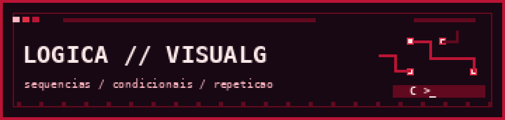

  

# Lógica de Programação • Visualg

*O começo da minha jornada com algoritmos.*

## `01 / organização`

| Pasta | Conteúdo |
|:--|:--|
| `estrutura-sequencial/` | Entrada, saída e cálculos básicos |
| `estrutura-condicional/` | Decisões e condições |
| `estrutura-repetitiva/` | Laços de repetição |
| `vetores/` | Vetores e processamento de dados |
| `matrizes/` | Operações com matrizes |

## `02 / como executar`

Abra o arquivo `.ALG` desejado no **Visualg** e execute-o no programa.

> Exercícios de aprendizagem. Indique as referências dos enunciados e dos exemplos, quando aplicável.
